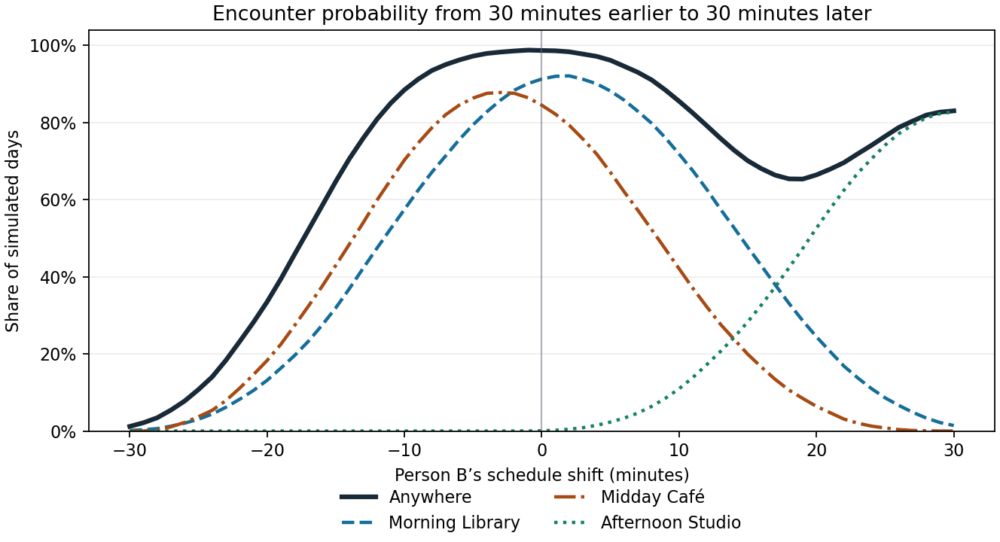

# Campus Encounter Simulator

How does a small schedule delay change the chance that two people cross paths? This Python notebook simulates two fictional campus itineraries and compares the chance of at least one encounter when Person B’s schedule shifts by up to 30 minutes in either direction.

Open [the executed notebook](campus_encounter_simulator.ipynb) to see the code, tables, and plot.



Each point reuses the same 20,000 simulated days. Negative shifts start Person B earlier, and positive shifts start B later.

## Run locally

From the repository folder, run these commands in a macOS or Linux terminal with Python 3 installed.

```bash
python3 -m venv .venv
source .venv/bin/activate
python -m pip install jupyterlab numpy matplotlib
python -m jupyterlab campus_encounter_simulator.ipynb
```

In JupyterLab, select the Python 3 kernel and choose **Kernel → Restart Kernel and Run All Cells**. The fixed random seed makes the simulation reproducible. The hand-checkable example tests both overlapping visits and visits that meet only at a time boundary.

## How the model works

- Two people follow fixed routes through five fictional campus locations. Outing start times and dwell durations vary across days. Walking times are fixed.
- An encounter requires both people to occupy the same location during the same one-minute interval. Walking and off-campus time are excluded.
- The notebook samples 20,000 synthetic days and replays each under all four delays. It compares outcomes day by day and breaks down encounters by campus location and time window.

## Main findings

The highest simulated rate in the sweep was 98.81% at a -1-minute shift.
At −30 minutes the overall rate was 1.20%. It fell through the first 15 minutes of delay, then rebounded to 83.06% at +30 minutes as afternoon Studio overlaps became more common.

| Person B’s delay | Days with at least one encounter | Change from baseline |
| ---: | ---: | ---: |
| 0 min | 98.72% | 0.00 pp |
| 5 min | 96.18% | −2.54 pp |
| 10 min | 85.56% | −13.16 pp |
| 15 min | 70.12% | −28.60 pp |

Morning Library overlaps accounted for the largest share of the daily decline at every tested delay. The notebook assigns each lost or gained day to its first encounter in the scenario where it had one. At 15 minutes, morning Library encounters contributed −27.64 percentage points by that rule. Midday Café overlaps also fell, while afternoon Studio overlaps increased.

The 15-minute change had an approximate 95% paired Monte Carlo interval of −29.26 to −27.94 percentage points. The decline persisted with a stricter definition. Requiring at least five total shared minutes lowered the estimate from 93.22% at baseline to 46.73% at a 15-minute delay. Those minutes may come from separate encounters.

A robustness check varied each walk by up to two minutes and gave each planned dwell a 10% chance of being skipped. The drop from baseline to a 15-minute delay was about 27–29 percentage points across all four models. The rebound from +15 to +30 minutes shrank with skipped stops and disappeared in the point estimates when both changes were applied.

**Five consecutive minutes at one location.** Replaying the same 20,000 days across all 61 shifts, we found that both the initial decline and the later rebound persisted under this stricter rule. Estimated encounter rates were 90.82% at baseline, 43.86% at +15 minutes, and 58.88% at +30 minutes. The initial drop grew from 28.60 to 46.95 percentage points, and the rebound was 15.01 points. A gap or location change resets the five-minute count. This check uses the original walking times and stops.

The estimates describe the fictional routes, schedules, and encounter rules in the notebook. The intervals quantify sampling variation within that model. Estimating encounter rates on a real campus would require observed schedules and movement data.

The matched-day design uses common random numbers. [Glasserman and Yao (1992), *Some Guidelines and Guarantees for Common Random Numbers*](https://business.columbia.edu/faculty/research/some-guidelines-and-guarantees-common-random-numbers)
